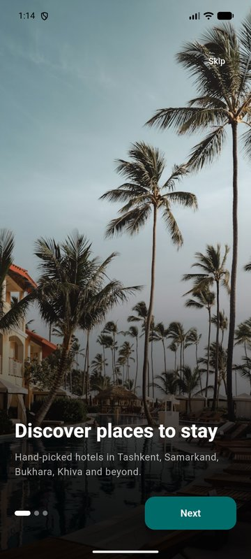
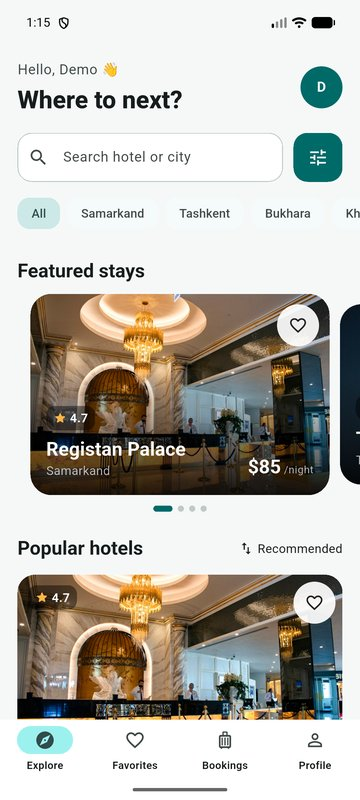
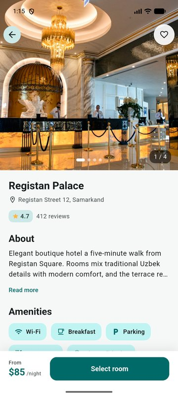
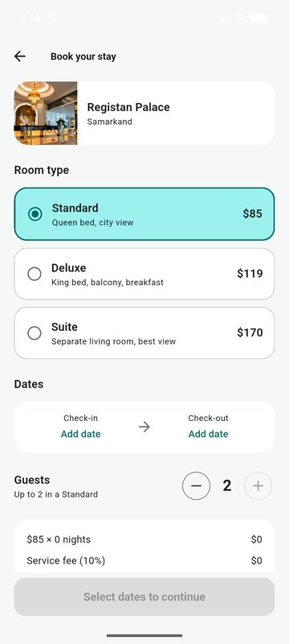
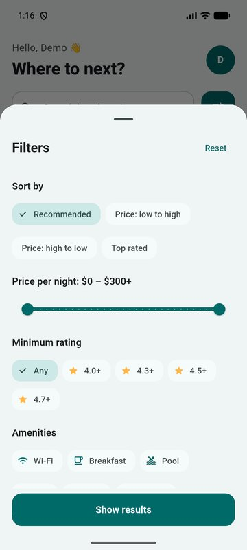

# Hotel Booking

A personal demo project: a hotel booking app for Android and iOS built with
Flutter.

> **Note:** this is a portfolio project. Hotels are sample data, hotel names
> are fictional and photos are illustrative. It runs in two modes:
>
> - **Cloud mode** (Firebase configured): accounts in Firebase Authentication,
>   favorites and bookings in Cloud Firestore.
> - **Demo mode** (Firebase not configured): everything stays on the device and
>   sign-in is simulated. Nothing is sent anywhere.

## Screenshots

| Onboarding | Explore | Hotel page | Booking | Filters |
|---|---|---|---|---|
|  |  |  |  |  |

Screenshots were taken on an Android emulator (Pixel 7).

## Design

Light, calm teal theme (with a dark mode switch), large photo cards with gradients, rounded Material 3 components and Hero transitions between the list and the hotel page.

## Features

- **Three languages**: Uzbek, Russian and English, switched in the profile
  (follows the phone language, falls back to Uzbek)
- **Onboarding** (3 slides, shown on first launch only)
- **Sign in / sign up** with form validation and translated error messages
- **Explore**: featured hotels carousel, city chips, live search, sort
- **Filters** in a bottom sheet: price range, minimum rating, amenities, sort
- **Hotel page**: Hero animation, photo gallery, amenities, expandable
  description, real **OpenStreetMap** map with "open in maps app", reviews
- **Booking flow**: room type, dates, guests, guest name and phone, payment
  choice (pay at the hotel, or a simulated online payment), price breakdown,
  booking code
- **Availability**: each hotel has a limited number of rooms per type; a sold-out
  night blocks the booking, and a guest cannot book the same hotel twice for
  overlapping dates. Reserving is done in a Firestore transaction.
- **Favorites** and **bookings** per account, cancel with confirmation
- **Profile**: stats, dark / light mode, language, log out
- Shimmer loading, empty and error states with retry, pull to refresh

## Stack

- Flutter / Dart, Material 3
- `flutter_bloc` (Cubit) for state management, `get_it` for dependency injection
- `firebase_auth` + `cloud_firestore` (cloud mode), `shared_preferences` (demo mode)
- `flutter_localizations` + ARB files (`lib/l10n`)
- `flutter_map` (OpenStreetMap, no API key) + `url_launcher`
- `cached_network_image` + `shimmer`
- Clean Architecture split: `domain`, `data`, `presentation`

## Structure

```
lib/
  main.dart                 app, theme, locale, Firebase start-up
  injection.dart            get_it setup (cloud or demo repositories)
  core/                     theme, l10n helpers, shared widgets
  l10n/                     app_en / app_uz / app_ru .arb
  features/
    auth/                   onboarding, login, AuthCubit, Firebase + local repos
    hotels/
      domain/               entities, filter, repository contracts
      data/                 sample hotels, local repos, firebase/ (Firestore)
      presentation/         cubits, pages, widgets
    profile/                profile page
firestore.rules             security rules for Firestore
tool/                       export + seed hotels into Firestore (optional)
```

## Firebase setup

1. Create a project in the [Firebase console](https://console.firebase.google.com),
   enable **Authentication -> Email/Password** and create a **Firestore** database.
2. Connect the app (replaces `lib/firebase_options.dart`):

   ```bash
   flutterfire configure
   ```

3. Publish the security rules:

   ```bash
   firebase deploy --only firestore:rules
   ```

4. Run the app. Hotels come from the bundled sample data until you fill the
   `hotels` collection (optional, see `tool/seed_hotels.mjs`).

The occupancy counters are updated by the app inside a transaction and the rules
limit them to +/- 1 per write. That is fine for a portfolio, but a production
system should reserve rooms in a Cloud Function, and take real payments through
a provider such as Payme, Click or Stripe (`PaymentGateway`).

## Run

```bash
flutter pub get
flutter run
flutter test
```

The app needs an internet connection for photos and map tiles.

## Possible next steps

- Hotels and reviews edited by an admin (admin app or Cloud Functions)
- Real payments (Payme / Click) behind `PaymentGateway`
- Push notifications for booking reminders
- Hotel descriptions translated per language

## Credits

Photos: [Unsplash](https://unsplash.com) (Unsplash License).
Map data: © [OpenStreetMap](https://www.openstreetmap.org/copyright) contributors.

## Author

Bekzod Abdurahimov, Flutter developer · [GitHub](https://github.com/Bekzod123bek)
